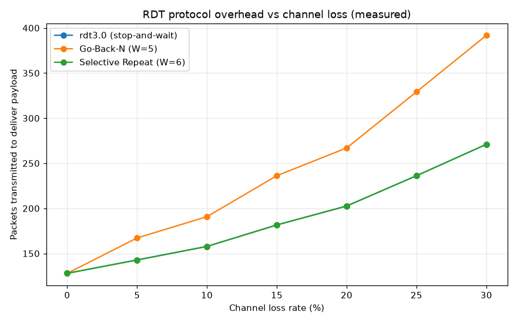

# USTC Computer Networking — Top-Down Labs

> Socket-programming, reliable-transport, routing and Mininet labs — an independent,
> from-scratch implementation of the lab track for
> **USTC 计算机网络 (Computer Networking: A Top-Down Approach)** by 郑烇 & 杨坚
> (University of Science and Technology of China), part of a
> [csdiy.wiki](https://csdiy.wiki/) full-catalog build.


## Overview

The USTC course follows Kurose & Ross's *Computer Networking: A Top-Down Approach*
and its companion **programming assignments** and **Wireshark labs**. This repo
implements that lab track end-to-end in Python: the classic socket-programming
assignments (web server, UDP pinger, SMTP client, caching HTTP proxy, ICMP pinger,
traceroute), the reliable-data-transfer protocol lab (rdt3.0, Go-Back-N, Selective
Repeat over a lossy channel), the distance-vector routing algorithm, and a scripted
Mininet topology lab. Everything actually runs and is verified — over real loopback
sockets, real raw ICMP sockets against the live internet, and a real Mininet
software-defined network.

## Results (measured on this machine: Windows 11 + WSL2 Ubuntu 24.04, CPU-only)

**Test suite: `25 passed` (Windows Python 3.11 and Linux Python 3.12).**

| Lab | What it does | Result (measured) |
|---|---|---|
| 0 · TCP client/server | line-oriented TCP echo/upper | round-trips `hello top-down` → `HELLO TOP-DOWN` ✓ |
| 1 · Web server | HTTP/1.1 file server | `200 OK` for existing file, `404 Not Found` for missing ✓ |
| 2 · UDP pinger | UDP ping w/ simulated loss | 10 sent, 8 received, **20% loss**, rtt avg 0.58 ms |
| 3 · SMTP mail client | hand-rolled SMTP over TCP | full HELO→MAIL→RCPT→DATA→QUIT session accepted (`250`) ✓ |
| 4 · HTTP proxy | caching proxy | 1st req `X-Cache: MISS`, 2nd req `X-Cache: HIT` ✓ |
| 5 · ICMP pinger | raw-socket ping | `8.8.8.8` ttl=108, **rtt avg 223 ms**, 0% loss (real internet) |
| 6 · Traceroute | raw-socket traceroute | reached `8.8.8.8` in **13 hops** (real internet) |
| 7 · Reliable data transfer | rdt3.0 / GBN / SR | all 3 deliver 1380 B correctly over 25%-loss/15%-corrupt/10%-reorder channel ✓ |
| 8 · Distance-vector routing | distributed Bellman-Ford | converges in a few rounds; **all costs match Floyd-Warshall** ✓ |
| 9 · Mininet dumbbell | SDN topology + iperf | pingAll **0% loss (12/12)**, iperf **8.40 Mbit/s** over 10 Mbit link, RTT 11.6 ms |

### Figure — reliable-transport overhead vs channel loss (measured)



Packets the sender must transmit to reliably deliver a fixed payload as loss rises.
**Go-Back-N** grows fastest (391.8 packets at 30% loss) because a timeout retransmits
the whole window; **Selective Repeat** and **rdt3.0** retransmit only what's needed
(271 packets). Generated by `results/make_figure.py` from real protocol runs.

## Implemented assignments

- [x] **Lab 0 — Simple TCP client/server** (§2.7.2)
- [x] **Lab 1 — Web Server** (Programming Assignment 1)
- [x] **Lab 2 — UDP Pinger** with simulated packet loss (Assignment 2)
- [x] **Lab 3 — SMTP Mail Client** speaking raw SMTP, no `smtplib` (Assignment 3)
- [x] **Lab 4 — HTTP Web Proxy Server** with on-disk caching (Assignment 4)
- [x] **Lab 5 — ICMP Pinger** with hand-built ICMP headers, raw sockets (Assignment 5)
- [x] **Lab 6 — Traceroute** via TTL-limited ICMP echo (Assignment 6)
- [x] **Lab 7 — Reliable Data Transfer**: rdt3.0, Go-Back-N, Selective Repeat (§3.4)
- [x] **Lab 8 — Distance-Vector routing** (distributed Bellman-Ford)
- [x] **Lab 9 — Mininet** dumbbell topology with connectivity + throughput tests
- [x] **Wireshark labs** — written analysis in [`wireshark-labs/`](wireshark-labs/README.md),
      backed by this repo's own HTTP / UDP / TCP / ICMP captures

## Project structure

```
top-down-labs/
├── labs/
│   ├── 00-tcp-clientserver/   tcp_server.py, tcp_client.py
│   ├── 01-webserver/          webserver.py, www/HelloWorld.html
│   ├── 02-udp-pinger/         udp_ping_server.py, udp_ping_client.py
│   ├── 03-smtp-mailclient/    smtp_client.py, mock_smtp_server.py
│   ├── 04-http-proxy/         proxy_server.py, proxy_client.py
│   ├── 05-icmp-pinger/        icmp_ping.py            (raw socket, Linux/sudo)
│   ├── 06-traceroute/         traceroute.py           (raw socket, Linux/sudo)
│   ├── 07-rdt/                channel.py, rdt.py
│   ├── 08-distance-vector/    distance_vector.py
│   └── 09-mininet/            topology.py             (Mininet, Linux/sudo)
├── tests/                     test_sockets.py, test_rdt.py, test_distance_vector.py
├── results/                   captured outputs + rdt_efficiency.png + capture scripts
├── wireshark-labs/            written analysis of the Wireshark lab series
├── requirements.txt
└── LICENSE
```

## How to run

```bash
# Python repos use the shared csdiy env (Python 3.11):
#   D:\Project\_csdiy\.venv-ml\Scripts\python.exe
python -m pip install -r requirements.txt   # only needs pytest

# Run the whole verified test suite:
python -m pytest tests/ -v

# Regenerate all captured results + the figure:
python results/capture_results.py
python results/make_figure.py

# --- Run individual labs live ---
# Lab 1 web server (then browse http://127.0.0.1:8080/HelloWorld.html):
python labs/01-webserver/webserver.py --port 8080

# Lab 2 UDP pinger (two terminals):
python labs/02-udp-pinger/udp_ping_server.py --port 12000 --loss 0.3
python labs/02-udp-pinger/udp_ping_client.py --port 12000 --count 10

# Lab 4 caching proxy (needs an origin server running):
python labs/04-http-proxy/proxy_server.py --port 8888
python labs/04-http-proxy/proxy_client.py --url http://127.0.0.1:8080/HelloWorld.html

# --- Raw-socket labs (Linux / WSL2, need root) ---
sudo python3 labs/05-icmp-pinger/icmp_ping.py 8.8.8.8 --count 4
sudo python3 labs/06-traceroute/traceroute.py 8.8.8.8 --max-hops 20

# --- Mininet lab (Linux / WSL2) ---
sudo apt-get install -y mininet openvswitch-switch openvswitch-testcontroller
sudo systemctl start openvswitch-switch
sudo python3 labs/09-mininet/topology.py --bw 10 --delay 5ms
```

## Verification

- **`pytest tests/` → 25 passed** (`results/pytest_output.txt`). The socket tests
  spin up each server on an OS-assigned free port and drive it over real loopback
  TCP/UDP; the RDT tests transfer data over channels configured to lose, corrupt,
  and reorder packets and assert byte-for-byte recovery; the distance-vector tests
  assert convergence and cross-check every path cost against Floyd-Warshall.
- **ICMP pinger / traceroute** were run with `sudo` in WSL2 against `8.8.8.8` —
  real echo replies (ttl=108, ~223 ms) and a real 13-hop path
  (`results/icmp_pinger.txt`, `results/traceroute.txt`).
- **Mininet** built a real OVS-backed dumbbell network: 0% ping loss and a measured
  8.40 Mbit/s iperf across the 10 Mbit bottleneck (`results/mininet.txt`).
- Captured lab outputs live in [`results/`](results/) and are regenerable with the
  two scripts above.

## Tech stack

Python 3 standard library only for the labs (`socket`, `struct`, `select`,
`threading`, `hashlib`) — no third-party runtime dependencies. `pytest` for tests,
`matplotlib` for the one figure, and **Mininet 2.3 + Open vSwitch 3.3** (Linux) for
Lab 9.

## Key ideas / what I learned

- Building application protocols directly on sockets: HTTP request/response framing,
  the SMTP command dialogue, and UDP's connectionless, loss-tolerant model.
- Crafting and parsing **ICMP** packets by hand (checksums, echo request/reply, TTL
  expiry) — the mechanics behind `ping` and `traceroute`.
- Implementing **reliable data transfer** from an unreliable channel: sequence
  numbers, cumulative vs selective ACKs, retransmission timers, and the sliding-window
  overhead trade-off between Go-Back-N and Selective Repeat (see the figure).
- The **distributed Bellman-Ford** distance-vector algorithm and proving its output
  against a centralised shortest-path computation.
- Driving a real software-defined network with **Mininet/OVS** to measure connectivity,
  bandwidth, and latency on an emulated topology.

## Credits & license

Based on the lab track of **Computer Networking: A Top-Down Approach** (Kurose &
Ross) as taught in USTC 计算机网络 by 郑烇 (Zheng Zhuo) and 杨坚 (Yang Jian).
Assignment specifications belong to their original authors; the official companion
materials are hosted at
[gaia.cs.umass.edu/kurose_ross](https://gaia.cs.umass.edu/kurose_ross/). Course
entry: [csdiy.wiki](https://csdiy.wiki/计算机网络/topdown_ustc/). This repository is
an independent educational reimplementation; original code here is released under the
[MIT License](LICENSE).
